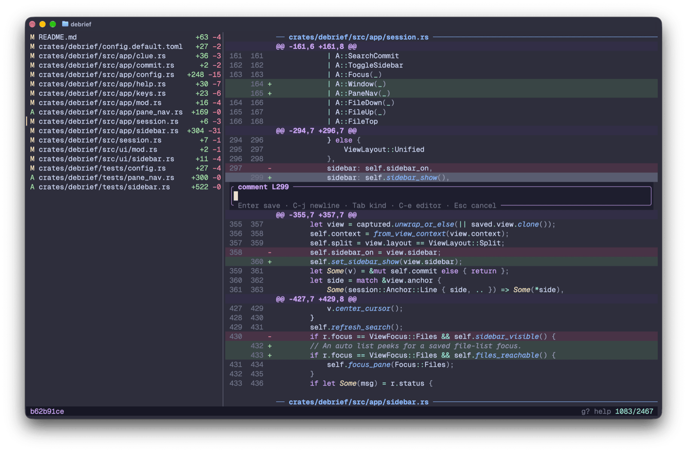

# debrief

**Catch up with what your coding agents committed, and answer back.**

debrief is a terminal tool for reading what coding agents committed in git
or jj. It shows which commits are new since you last looked, shows each one
as a single diff, takes comments on diff lines, and hands them back to the
agent as one markdown review.



## Why it's good

- **It knows what you haven't read.** The log marks new commits `●`, and
  jj commits rewritten since you saw them `◐`. It opens on the oldest one
  you haven't seen. Uncommitted work shows as a row of its own.
- **A commit is one diff.** Every file in one highlighted stream, with a
  file list beside it. `T` switches between hunks and whole files, `t`
  between unified and side by side.
- **Comments go back to the agent.** `cc` comments on a line, `v` … `c` on
  a range, and Tab marks a comment as an issue, suggestion, question or
  nit. `<leader>rr` sends the batch as one markdown review: to the mu agent
  working in that repo with `debrief-send`, to any command, or to the
  clipboard.
- **It shares the review with ramble.** Comment on the plan in
  [ramble](https://github.com/martintrojer/ramble) and on the commit that
  implemented it in debrief, then send both at once.
- **You can pick up where you stopped.** `<leader>ss` saves a commit's
  comments and view; reopening the commit restores them, and quitting with
  unsaved work asks first.
- **It never writes to your repo.** No checkout, amend or index refresh,
  and reviews live outside it: the comment batch and seen marks in your
  cache dir, saved sessions in your state dir. The one exception is jj's
  working-copy snapshot, which ordinary jj commands take too;
  `--no-snapshot` turns it off.
- **Your fingers already know it.** Vim motions, search and visual mode;
  `g?` lists every key, and `C-h/j/k/l` move between panes and on into
  tmux.

## What it isn't

- **A git client.** No staging, committing or rebasing.
- **A forge or PR review tool.** It reviews local commits and hands the
  review to whoever made them.
- **An editor.** `<leader>o` opens `$EDITOR` at the line.
- **A markdown reader.** `.md` files open in ramble.

## Install

Prebuilt binaries for macOS (Apple silicon) and Linux (x86_64) are on the
[releases page](https://github.com/martintrojer/debrief/releases), or:

```sh
cargo install --path crates/debrief
```

You need `git` or `jj` on `PATH`. The log's session marker is a Nerd Font
glyph.

## Use

```sh
debrief                    # the repo holding the working directory
debrief path/to/repo       # any path inside a repo
debrief --revset 'main..'  # jj revset or git revision range
```

No config needed. `debrief --init-config` writes every option, commented
out.

## More

- [Guide](docs/guide.md): the log, the commit view, keys, comments,
  sessions, sending, tmux
- [Default config](crates/debrief/config.default.toml): every option, with
  its default
- [Design](docs/design.md): how it works and why

Young and moving fast. MIT licensed.
